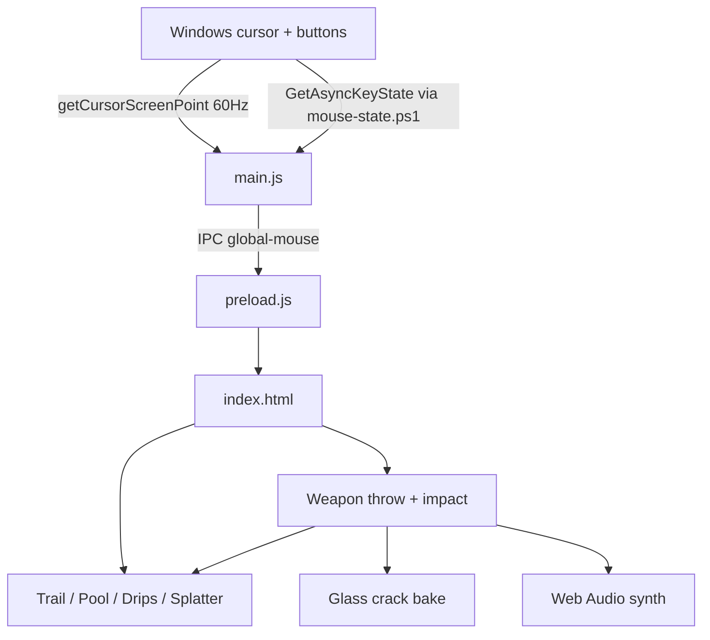
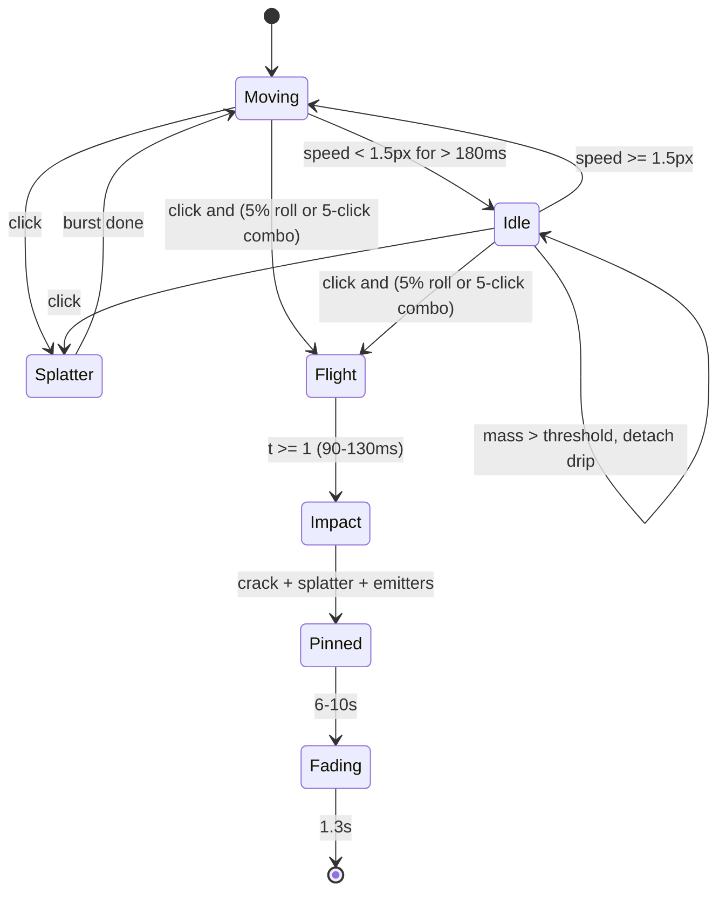

# Technical Design: Bleeding Canvas Overlay (Electron)

## Overview

Electron main process polls the OS cursor and buttons and streams them to a transparent renderer that simulates fluid, weapons and glass on stacked canvases. Normal clicks only splatter blood; weapon throws are rare (5% or a rapid combo).

## Architecture

Files in `src/apps/bleeding-canvas/`: `main.js`, `preload.js`, `native/mouse-state.ps1`, `index.html`, `physics-types.ts`, `assets/weapons/*.png`.

## Components and Interfaces

### Window
Transparent, frameless, `alwaysOnTop('screen-saver')`, `skipTaskbar`, `hasShadow:false`, `focusable:false`, bounds = primary display, `setIgnoreMouseEvents(true, {forward:true})`. `fullscreen:true` is not used because it breaks transparency on Windows. Hardware acceleration is disabled (GPU crash with transparent windows on some drivers).

CLI flags: `--demo` (scripted showcase every 16 s), `--debug` (detached DevTools), `--snapshot` (saves `capturePage()` PNGs to the temp dir at 2.5/4.5/9/13 s for headless verification).

### Canvas Stack (bottom to top)
`crack` -> `rim` (goo + drop-shadow) -> `body` (goo) -> `ecto` (goo + purple glow, hidden when empty) -> `gloss` -> `weapon` -> `fx` (pulp, seeds).

### Cursor & Weapon State Machine

### Weapon Model
Art lives in a 500x500 frame. Each def has `anchor` (impact point), and for blades `normal` (buried edge -> visible metal) and `bury` (art px). At load the blade anchor is moved `bury` px along `normal` from the cutting edge, so the glass line sits mid-blade and the front half is clipped away. On impact the weapon is baked once into an offscreen canvas: clip to the half-plane on the `+normal` side of a jagged fault polyline, `source-atop` depth gradient + seam strokes, then a drop shadow whose offset is rotated back into art space. Per frame it is just one `drawImage` with translate/rotate/scale.

### Drip Model
- Stuck: `vy = 0.12`, `load += 0.045 * sqrt(mass)`; when `load >= friction`, slip with `vy = 3.2 + 0.35 * mass`.
- Slipping: `vy *= 0.968`/frame; below 0.45 it sticks again with new friction.
- Tail every 3 px with the R3.2 radius, merged into capsules of up to 12 px. Mass drains per pixel: `dm/dy = -(0.01 + 0.012 m)` (about 90 px at mass 4, 200 px at mass 19). Ends at mass < 0.8, floor, or 15 s.

### Aging
`< 4 s` fresh; `4-10 s` lerp to the kind's dry color, gloss down to 20%; `10 s-life` alpha and radius fade, swap-remove. Rim grows by `min(1.8, 0.3r)` so thin rays keep their red core after the goo threshold.
## Data Models

Defined in `physics-types.ts`: `GlobalMouseEvent`, `FluidKind`, `BloodNode` (circle, or capsule when `x2/y2` set), `BloodDrip`, `BloodParticle`, `WeaponDef`, `Weapon`, `GlassCrack`, `DripEmitter`.

## Correctness Properties

- A spinning weapon's angle equals `finalAngle` exactly at flight `t = 1`.
- No two weapon throws happen less than 1.5 s apart; a throw resets the combo.
- Every node is removed once `age >= life` (at most 15 s); node count never exceeds 9000.
- Weapons and cracks are removed within `pinMs + 1.3 s` of impact.
- Drip tail radius stays within `[0.2, 0.85] * headRadius`.

## Error Handling

- Missing weapon PNG: procedural art is used (logged to console).
- Button helper fails to start: cursor tracking keeps working, clicks come only from the DOM fallback.
- Shortcut already taken by another app: a warning is logged and the other shortcuts still register.
- Node cap reached: new nodes recycle existing slots so fresh blood always shows.

## Testing Strategy

- `node --check` on `main.js` and the inline renderer script.
- `npm run demo -- --snapshot` saves renderer frames to the temp dir at 2.5/4.5/9/13 s for visual review of trail, plain splatter, each weapon, embed depth, cracks and aging. Measured peak during the demo: about 5,200 nodes.