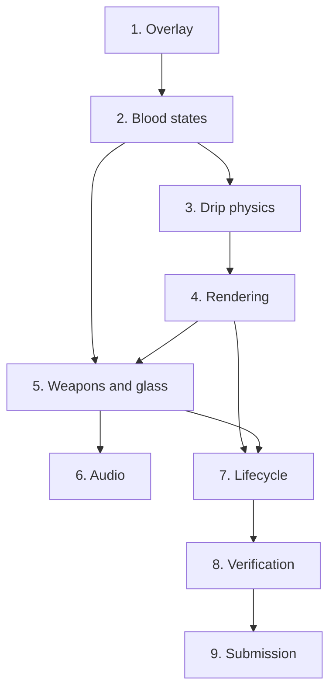

# Implementation Plan: Bleeding Canvas Overlay (Costume Contest Track)

## Overview

Electron click-through desktop overlay with cursor-driven blood, weapon throws and glass shatter. Requirement IDs refer to requirements.md.

## Tasks

- [x] 1. Electron global overlay (R1)
  - [x] 1.1 Transparent, frameless, always-on-top (`screen-saver`), skipTaskbar, no shadow, non-focusable window
  - [x] 1.2 `setIgnoreMouseEvents(true, { forward: true })` click-through
  - [x] 1.3 60Hz cursor polling + `GetAsyncKeyState` button helper, IPC `global-mouse`
  - [x] 1.4 DOM fallback, `setInterval` render loop
  - [x] 1.5 Shortcuts: `Ctrl+Shift+B` toggle, `Alt+Q` quit, `Ctrl+Alt+B` clear
  - [x] 1.6 `npm start`, `npm run demo`, `npm run start:debug` scripts
- [x] 2. Cursor-driven blood states (R2)
  - [x] 2.1 State A: speed-dependent smear
  - [x] 2.2 State B: idle pooling and detaching heavy drop
  - [x] 2.3 State C: click -> 15-25 droplet burst + micro-spatter rays
  - [x] 2.4 Rare weapon trigger: 5% chance or 5-click rapid combo, 1.5 s cooldown
- [x] 3. Drip physics (R3)
  - [x] 3.1 Stop-and-go surface tension
  - [x] 3.2 Tapered tails with mass loss and coagulation
  - [x] 3.3 Sine micro-meandering
- [x] 4. Visceral rendering (R4)
  - [x] 4.1 `visceral-goo` metaball filter on transparent canvases
  - [x] 4.2 Rim / arterial body / specular highlight layers
- [x] 5. Weapon throw & glass shatter (R5)
  - [x] 5.1 PNG loading with procedural knife, axe, pumpkin, ghost fallback art
  - [x] 5.2 Weighted spawn, 90-130 ms flight, spin unwound to exact lock angle, spring recoil
  - [x] 5.3 Pumpkin tumble, squash-and-stretch, pulp/seeds/juice burst
  - [x] 5.4 Ghost wobble, squish, 2.5 s slide with purple/green slime trails
  - [x] 5.5 Procedural cracks: 8-14 rays, branches, 2-4 rings, double stroke
  - [x] 5.6 Deep embed mask (front half of blade hidden), seam shading, baked drop shadow
  - [x] 5.7 Drip emitters at crack center and lowest visible seam point
- [x] 6. Procedural audio (R6)
  - [x] 6.1 Glass shatter + embed thud
  - [x] 6.2 Wet splat with LFO band-pass
  - [x] 6.3 Ghost shimmer
- [x] 7. Lifecycle (R7)
  - [x] 7.1 Weapons/cracks pinned 6-10 s, slip and fade, 12-weapon cap
  - [x] 7.2 Fresh / coagulating / evaporating fluid with node removal
  - [x] 7.3 Node budget: capsule streaks/tails, per-pixel drip drain, slot recycling at cap
- [x] 8. Verification
  - [x] 8.1 Syntax check of main and renderer scripts
  - [x] 8.2 `--demo --snapshot` run: renderer frames captured and inspected at 2.5, 4.5 and 9 s
- [ ] 9. Submission
  - [ ] 9.1 Record demo video (manual: `npm run demo` + screen recorder)
## Task Dependency Graph



```json
{
  "waves": [
    { "wave": 1, "tasks": ["1"] },
    { "wave": 2, "tasks": ["2"] },
    { "wave": 3, "tasks": ["3"] },
    { "wave": 4, "tasks": ["4"] },
    { "wave": 5, "tasks": ["5"] },
    { "wave": 6, "tasks": ["6", "7"] },
    { "wave": 7, "tasks": ["8"] },
    { "wave": 8, "tasks": ["9"] }
  ]
}
```

## Notes

- Launch: `npm start`. Showcase: `npm run demo`. DevTools: `npm run start:debug`.
- `fullscreen: true` is replaced by display-sized bounds because it breaks transparency on Windows.
- Task 9.1 is a manual recording step.